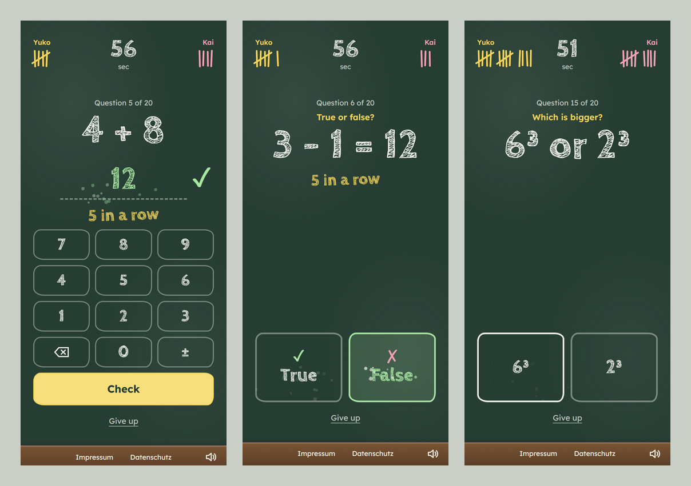
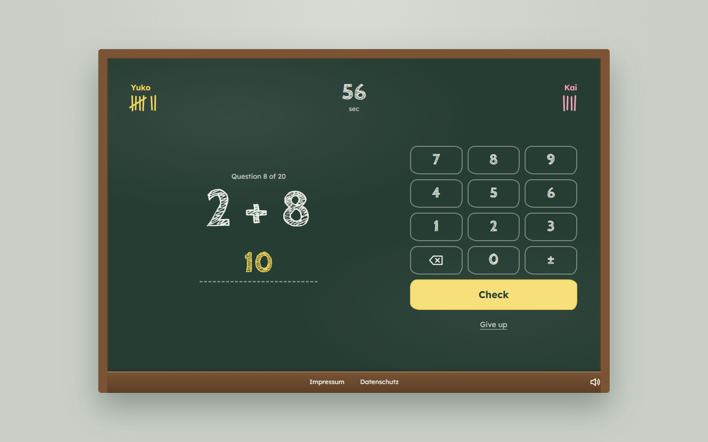
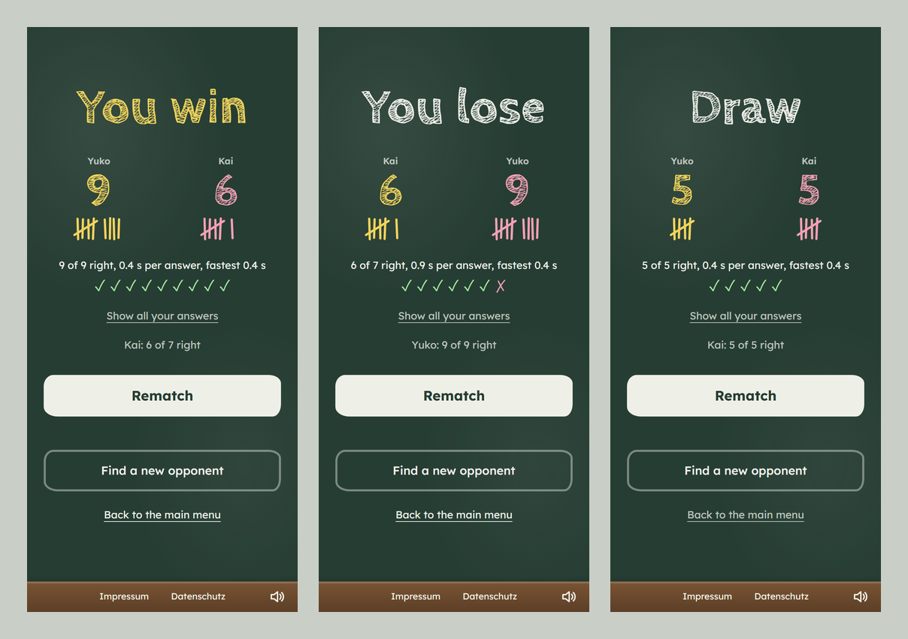

# MathWars

[](https://github.com/Yuneste/warduel/actions/workflows/ci.yml)

Real-time multiplayer math duel: two players race to solve 20 problems in 60 seconds, on a chalkboard.

**[▶ Play live](https://mathwars-6k6s.onrender.com)** (free hosting: the first visit after a quiet spell can take up to a minute while the server wakes up)



| Desktop | Every ending |
|---|---|
|  |  |

## Features

- Real-time 1v1 matches via WebSocket: random opponent, or challenge a friend with an invite link or code (they get a popup with 10 seconds to accept)
- Nicknames, and post-game stats with every answer and how long it took
- Leaderboard of public games (no accounts: a random device ID, stored only as a SHA-256 hash)
- Four challenge types: Classic, True or false, Missing number and Which is bigger (fractions, powers, roots); problems get harder through the game and never repeat
- 60-second rounds with live score updates
- Rematch system for consecutive games
- Chalkboard design built phone-first: scores drawn as tally marks, on-screen number pad with haptic feedback
- Full keyboard play on desktop (digits, Backspace, minus, Enter; arrows or T/F in button modes)
- Sound synthesized live with the Web Audio API (no audio files), chalk-dust effects, streak call-outs; mute and reduced-motion respected

## Tech Stack

**Backend:**
- Java 17+ (tested on 17 and 25) + Spring Boot 3.5
- WebSocket (TextWebSocketHandler)
- Concurrent game management with thread safety
- Rate limiting and connection monitoring
- Spring Data JPA (H2 locally, PostgreSQL in production) for the leaderboard

**Frontend:**
- Vanilla JavaScript ES6 modules
- WebSocket API for real-time communication
- Hand-written CSS with design tokens, no framework
- Self-hosted fonts (no third-party requests)

## Quick Start

### Prerequisites
- Java 17+ (Maven is included via the wrapper)

### Run Locally

```bash
git clone https://github.com/Yuneste/warduel.git
cd warduel
./mvnw spring-boot:run
```

Open `http://localhost:8080` in two browser windows to play.

### Tests

```bash
./mvnw test
```

Besides unit tests for the game rules, matchmaking and message format, `GameWebSocketIntegrationTest` starts the server on a random port and plays real matches with two WebSocket clients: countdown, timer, win score, rematch, forfeit, disconnects and rate limiting.

## Deploy (free, no domain needed)

The repo deploys to [Render](https://render.com) as a Docker web service, with the leaderboard in a free [Neon](https://neon.tech) Postgres database. Both are free and need no credit card.

1. **Database (optional, 3 min):** create a Neon project in the **Frankfurt** region and copy its connection string (`postgresql://…?sslmode=require`). Without it the app runs on an in-memory database, and the leaderboard resets whenever the app restarts.
2. **App (5 min):** in Render choose **New → Blueprint**, connect this GitHub repository, and paste the Neon string when asked for `DATABASE_URL`. `render.yaml` sets up the rest: Docker build, free plan, Frankfurt, auto-deploy on every push to `main`.
3. The game is live at `https://<service-name>.onrender.com`.

Notes:
- Free Render services sleep after 15 minutes without visitors; the first visit after that takes up to a minute while it wakes up.
- `DATABASE_URL` is translated into Spring's datasource settings by `DatabaseUrlEnvironmentPostProcessor`. If the database can't be reached, the app refuses to start, so a typo shows up immediately in Render's logs.
- The WebSocket origin check uses `RENDER_EXTERNAL_URL`, which Render sets automatically.
- CI builds the Docker image and runs the app against a real Postgres, including a restart, on every push.

## Project Structure

```
src/main/java/com/warduel/warduel/
├── websocket/      # GameWebSocketHandler: game flow, timers, challenges, rate limiting
├── service/        # GameService (matchmaking, private rooms), QuestionGeneratorService
├── model/          # GameSession state machine, Player, Question, ChallengeType
├── leaderboard/    # JPA entity, repository, service and REST endpoint
├── dto/            # WebSocket message types
├── config/         # WebSocket, security, game settings, DATABASE_URL support
└── controller/     # Serves the page and the legal pages

src/main/resources/
├── templates/index.html      # the single page: lobby, waiting, game, result, leaderboard
└── static/
    ├── css/style.css         # chalkboard design tokens and layout
    ├── fonts/                # self-hosted Cabin Sketch + Lexend (OFL)
    └── js/modules/           # websocket, messageHandlers, uiController, sound, effects, ...
```

## How It Works

1. A player picks a name and either joins public matchmaking or creates an invite link for a friend.
2. Opening an invite link challenges its creator, who has 10 seconds to accept.
3. Both players are introduced, a 3-second countdown runs, and the 60-second clock starts only after it.
4. Each player solves their own 20 problems of the same challenge type; scores update live on both screens.
5. The first to 20 correct answers wins on the spot, otherwise the higher score when time runs out.
6. The result screen shows every answer and its timing; players can rematch, find someone new, or go back to the menu.

## Key Features

**Backend:**
- Every round's countdown, timer and connection monitor are registered on the game and cancelled when it ends, so a stale timer can never end a rematch
- Thread-safe sends (`ConcurrentWebSocketSessionDecorator`), per-player locking for answers, and a lock per game for rematch requests
- Matchmaking, single-use private rooms and challenge handshakes in `GameService`
- Rate limiting (10 messages per second per player) and heartbeat-based timeout detection
- Leaderboard with hashed device tokens; results are written off the game thread

**Frontend:**
- Vanilla ES modules, no framework or build step
- Phone-first layout, keyboard support, `prefers-reduced-motion`, visible focus styles
- Sound synthesized with the Web Audio API; chalk-dust effects and streak callouts

**Testing:**
- Unit tests for the rules, the state machine, matchmaking, challenges and the leaderboard
- Every challenge type is checked against an independent answer key
- Integration tests that play real matches over WebSocket against the running server

## License

MIT License - See [LICENSE](LICENSE) file for details.
